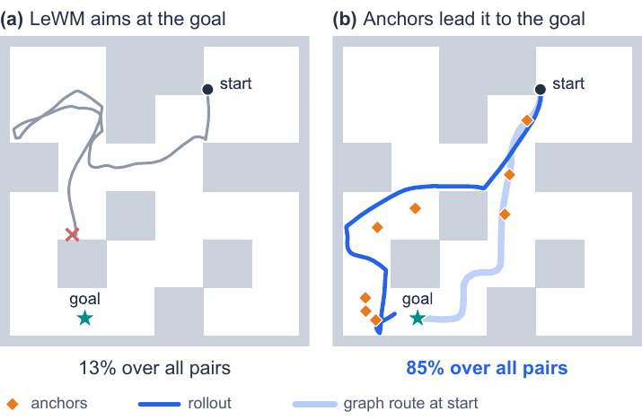

<div align="center">

# Long-Horizon Planning with Latent World Models via Graph Anchors

**Syed Nazmus Sakib**<sup>1</sup>, **Abdul Monaf Chowdhury**<sup>1</sup>, **Peizhen Li**<sup>3</sup>, **Nafiul Haque**<sup>1</sup>, **Chandak Chakma**<sup>1</sup>, **Md Mehedi Hasan**<sup>1</sup>, **Zehong Cao**<sup>3</sup>, and **Shifat E. Arman**<sup>1,2,*</sup>

<sup>1</sup> Department of Robotics and Mechatronics Engineering, University of Dhaka<br>
<sup>2</sup> Department of Engineering Science, University of Oxford<br>
<sup>3</sup> School of CSIT, Adelaide University<br>
<sub><sup>*</sup>Corresponding author: <code>shifat.arman@eng.ox.ac.uk</code></sub>

<p>
  <a href="https://syed-nazmus-sakib.github.io/graph-anchors/"></a>
  <a href="https://syed-nazmus-sakib.github.io/graph-anchors/assets/paper.pdf"></a>
  <a href="LICENSE"></a>
</p>



</div>

---

## Overview

Latent world models plan by rolling out candidate action sequences in imagination and scoring each plan by the latent distance between its predicted end state and a goal image. We show that this goal cost fails in **two distinct ways**:

1. **Range failure:** Whole-image latent distance ranks local moves accurately next to the goal ($\rho(1) \approx 0.91\text{--}1.00$), but loses directional signal within ~6 graph hops across navigation tasks and across **six visual representations** (raw pixels, DINOv2, CLIP, SigLIP, V-JEPA 2, and LeWM).
2. **Focus failure:** Whole-image latent distance weights the robot arm far more heavily than the manipulated object across all nine Meta-World object tasks we test, causing contact tasks to park the arm while leaving the object behind.

Both failures share a single remedy: **replace the distant goal with a nearby target that lies on a recorded trajectory.**

**Graph Anchors** is a **training-free** planner for frozen latent world models. It builds a sparse graph once over the world model's own training frames (5-step grid, fixed 1-block neighbor radius $\tau$), finds the shortest path to the goal via cached Dijkstra, and aims the unchanged CEM planner at an anchor node a few moves ahead—preserving continuous recorded transitions via a cross-episode switch cost $\lambda$ whenever object contact matters, and executing each plan up to its closest approach.

---

## Headline Results

All evaluations use identical start/goal pairs, frozen checkpoints, and $2d$ step budgets (50 pairs per seed, mean $\pm$ std across seeds).

### Long-Horizon Benchmarks (Table 1)

| Method | Push-T ($d{=}150$) | Two-Room ($d{=}75$) | PM-M ($d{=}200$) | PM-M Stitched | PM-L ($d{=}400$) | PM-L Stitched | Reacher ($d{=}150$) |
| :--- | :---: | :---: | :---: | :---: | :---: | :---: | :---: |
| LeWM | 5 ± 4 | 31 ± 3 | 13 ± 2 | 39 ± 10 | 8 ± 0 | 5 ± 1 | 60 ± 6 |
| LeWM + min-over-plan | 9 ± 1 | 62 ± 10 | 12 ± 5 | 41 ± 4 | 26 ± 6 | 17 ± 1 | **77 ± 5** |
| PLDM | 0 ± 0 | 50 ± 6 | 3 ± 3 | 28 ± 4 | 1 ± 1 | 2 ± 0 | 15 ± 1 |
| GCIVL | 0 ± 0 | 81 ± 2 | 0† | 16 ± 0 | 1 ± 1 | 3 ± 1 | 0 ± 1 |
| GCIQL | 0 ± 0 | 37 ± 4 | 1 ± 1 | 12 ± 3 | 3 ± 1 | 3 ± 1 | 0 ± 0 |
| HILP | 0 ± 0 | 87 ± 3 | 1 ± 1 | 18 ± 0 | 9 ± 1 | 10 ± 6 | 0 ± 0 |
| **Graph Anchors (navigation)** | 30 ± 3 | 93 ± 1 | 85 ± 6 | **95 ± 4** | **87 ± 1** | **66 ± 6** | 68 ± 4 |
| **Graph Anchors (contact, $K{=}2, \lambda{=}3$)** | **71 ± 3** | **100 ± 0** | **94 ± 5** | 91 ± 4 | 13 ± 6 | 9 ± 5 | 54 ± 11 |

### Head-to-Head Comparison of Training-Free World-Model Planners (Table 3)

| Method | PM-M 100 | PM-M 200 | Two-Room 75 | Push-T 50 | Push-T 150 | **Mean (far)** | PM-L 400 (`lewm_pml`) | PM-L Stitched |
| :--- | :---: | :---: | :---: | :---: | :---: | :---: | :---: | :---: |
| LeWM | 25 | 13 | 31 | 41 | 5 | 16.3 | 10 | 6 |
| AP (uses oracle $d$) | 91 | 80 | 97 | 82† | 65 | 80.7 | 18 | 9 |
| NGC ($N{=}5\text{k}$) | **97** | **100** | 99 | 59 | 11 | 70.0 | 24 | 20 |
| Metro-WM-style (tuned) | 95 | 96 | 99 | 72 | 33 | 76.0 | 6 | 6 |
| **Graph Anchors (nav.)** | 89 | 85 | 93 | 65 | 30 | 69.3 | **76** [87] | **45** [66] |
| **Graph Anchors (contact)** | **97** | 94 | **100** | **85** | **71** | **88.3** | 13 | 9 |

> **Scaling efficiency:** On an RTX 3090 Ti, Graph Anchors indexes all **199k–200k** training nodes in **72.9 MB** with **64.6 ms** per-decision GPU overhead (and 84–93 ms cached CPU Dijkstra), running **26.8× faster** while indexing **40× more nodes** than NGC ($N{=}5\text{k}$).

---

## Repository Structure

```text
graph-anchors/
├── graph_anchors/                 # Core Graph Anchors planner, diagnostics, and compared planners
│   ├── paa_nodes.py               # Encode the 5-step dataset grid into frozen-encoder graph nodes
│   ├── paa_cost.py                # Graph Anchors: sparse graph, Dijkstra, span K, switch cost lambda, pass-through CEM
│   ├── metro_graph.py             # Metro-WM-style sub-goal graph planner (re-implementation)
│   ├── ngc_cost.py                # NGC latent geodesic cost (re-implementation)
│   ├── graph_policy.py            # Latent graph waypoints for offline GCRL policies (GCBC, GCIVL, HILP)
│   ├── value_graph.py             # Value-graph search (GAS / TTGS-style)
│   ├── stitch_nodes.py            # Nodes built from an unseen dataset (PointMaze-Large stitch data)
│   ├── exp_encode.py              # Multi-encoder extraction (LeWM, PLDM, DINOv2, CLIP, SigLIP, V-JEPA 2, raw pixels)
│   ├── exp_ref.py                 # True-position reference graph builder
│   ├── exp_range.py               # Ranking test rho(h) with goal-level bootstrap confidence intervals
│   ├── e1_maps.py                 # Latent-distance maps and PCA projections
│   ├── fetch_lewm_data.py         # Public dataset and checkpoint downloader (LeWM / LP2 / OGBench)
│   └── area_probe_mw.py           # Meta-World focus / exchange-rate diagnostic probe
├── third_party/
│   ├── stable-worldmodel.patch    # Evaluation hooks, planner interfaces, and trace logging patch
│   └── stable-worldmodel-new-files/ # PointMaze environments and Hydra evaluation configs
├── scripts/
│   ├── run_eval.sh                # Main planner evaluation runner (LeWM, Graph Anchors, AP, NGC, Metro-WM, ablations)
│   ├── run_baselines.sh           # Offline policies (GCBC, GCIVL, GCIQL, HILP), PLDM, and DINO-WM
│   └── run_range_diagnosis.sh     # Six-encoder universal range test on identical frames and goals
├── tests/
│   └── test_metro_graph.py        # Unit tests for Metro-WM graph calibration and sub-goal search
└── docs/                          # GitHub Pages project website (29 rollout & diagnostic videos + paper PDF)
```

---

## Setup

The planner runs on top of [`stable-worldmodel`](https://github.com/galilai-group/stable-worldmodel) (MIT license) at a fixed revision, with an optional setup for [`jepa-wms`](https://github.com/facebookresearch/jepa-wms) if reproducing the Meta-World focus probe.

### 1. Clone and patch `stable-worldmodel`

```bash
git clone https://github.com/syed-nazmus-sakib/graph-anchors.git
cd graph-anchors

git clone https://github.com/galilai-group/stable-worldmodel.git third_party/stable-worldmodel
cd third_party/stable-worldmodel
git checkout 8b2e8c685dd7f11d4189f5c09d9b6bfffd5cdca4
git apply ../stable-worldmodel.patch
cp -r ../stable-worldmodel-new-files/. .
pip install -e .
cd ../..
```

### 2. Environment variables

```bash
export JEPAWM_HOME="$(pwd)"
export SWM_PY="$(which python)"
export STABLEWM_HOME="$HOME/.stable_worldmodel"   # cache for datasets & checkpoints (~45 GB with PM-L)
```

### 3. Optional: Meta-World focus probe (`jepa-wms`)

To reproduce the Meta-World arm-vs-object exchange-rate probe, clone `jepa-wms` at revision `13cf1d9c7e476f53c17714d2e0f1dc239a883ce0` into `third_party/jepa-wms` and copy `graph_anchors/area_probe_mw.py` into `third_party/jepa-wms/evals/failure_attribution/`.

---

## Reproducing Paper Evaluations

Supported environments: `pusht`, `tworoom`, `pmm` (PointMaze-Medium), `pml` (PointMaze-Large; set `PML_CKPT` to the trained LeWM checkpoint), `cube` (OGBench-Cube), and `reacher`.

```bash
# 1. Navigation setting (K=6, lambda=1, H=10): PointMaze-Medium, seeds 0 42 1, all distances
OFFS="50 100 150 200" SPANS=6 bash scripts/run_eval.sh pmm "0 42 1" out/pmm all

# 2. Contact setting (K=2, lambda=3, H=2, closest-approach execution): Push-T d=150, seeds 0 42 1
OFFS=150 SPANS=2 HA=2 EVX="plan_config.receding_horizon=2 +paa_exec=pass +paa_switch=3" \
  bash scripts/run_eval.sh pusht "0 42 1" out/pusht anchor

# 3. Stitched cross-episode goals at budget 400 (add XM=gacs for contact setting)
XB=400 bash scripts/run_eval.sh pmm "0 42" out/pmm cross

# 4. Head-to-head training-free planners (AP, NGC, Metro-WM-style) on identical pairs
bash scripts/run_eval.sh pmm "0 42 1" out/pmm ap
bash scripts/run_eval.sh pmm "0 42 1" out/pmm ngc
bash scripts/run_eval.sh pmm "0"      out/pmm metro

# 5. Offline goal-conditioned policies & PLDM baselines
bash scripts/run_baselines.sh pmm "gcbc gcivl gciql hilp pldm" out/bl_pmm

# 6. Offline range diagnosis across six visual representations (incl. raw pixels & V-JEPA 2)
bash scripts/run_range_diagnosis.sh pmm out/e1_pmm
```

Each run writes `[summary] env=... seed=... goal_offset=... success_rate=... n=50` to stdout and appends it to `<out>/summary.txt`.

### Running unit tests

```bash
python -m unittest discover -s tests -v
```

---

## Citation

If you find this work or codebase useful, please cite:

```bibtex
@article{sakib2026graphanchors,
  title   = {Long-Horizon Planning with Latent World Models via Graph Anchors},
  author  = {Sakib, Syed Nazmus and Chowdhury, Abdul Monaf and Li, Peizhen and Haque, Nafiul and Chakma, Chandak and Hasan, Md Mehedi and Cao, Zehong and Arman, Shifat E.},
  journal = {arXiv preprint},
  year    = {2026},
  url     = {https://syed-nazmus-sakib.github.io/graph-anchors/}
}
```

## License

This project is released under the [MIT License](LICENSE).
